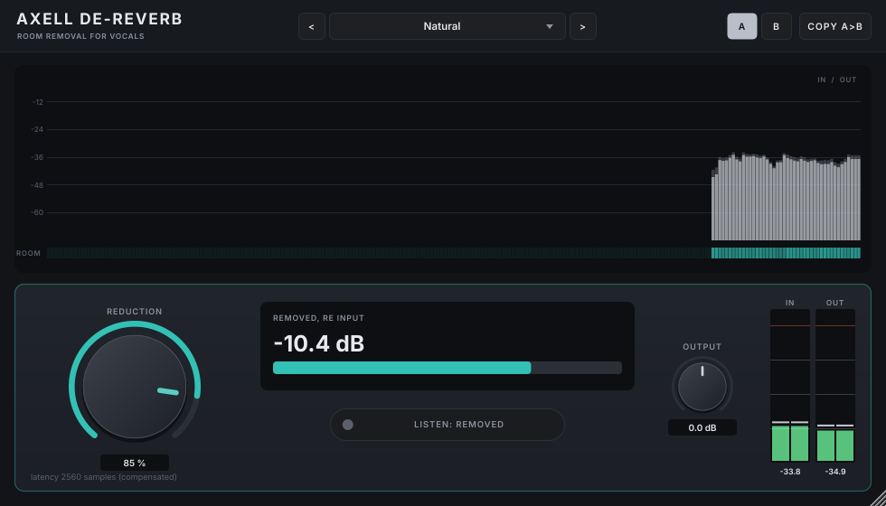

# Axell De-Reverb (VST3, Linux)

The de-reverb of the Axell suite. It removes the room from a close vocal:
- **the tail** of a bare bedroom or a bathroom;
- **the early reflections and the 350-600 Hz box** of a wardrobe booth, a closet or a car, which most de-reverbs
  leave alone because they were built for long tails in big rooms.

More screens: [LISTEN: REMOVED](docs/screenshots/dereverb-listen.png), [REDUCTION 75 %](docs/screenshots/dereverb-75pct.png).

## What it does

- **A trained network** runs on your CPU (no internet, nothing to install). It predicts, for every moment and
  frequency, how much of the sound is your voice and how much is the room. Below 4.5 kHz it also undoes the room with
  a short complex filter over several frames, so it can remove reflections that arrive within a few milliseconds of
  the voice.
  - **Training:** 80 speaking voices (women and men, 11 accents) and 16 singers, in 4,000 simulated small rooms
    (booths, closets, cars, bedrooms, bathrooms) and 7 measured rooms.
  - **10 % of the training had no room at all:** a dry take must come out as it went in.
- **REDUCTION** 0-100 %. The default 85 % was the best balance on the benchmark (DECISIONS D9). At 0 % the output is
  the input, delayed.
- **LISTEN: REMOVED** plays only what is taken away (processed + removed = the input).
- **OUTPUT** -24 to +24 dB. In/out meters, a REMOVED meter and a room history.
- **Presets:** Natural (85 %), Clean (100 %), Gentle (60 %). User presets and A/B.
- **Latency:** 2560 samples at 48 kHz (53 ms), reported to the host and compensated. The plugin is for mixing; there
  is no low-latency mode for monitoring while recording.
- **Any sample rate:** 44.1 to 96 kHz. The network runs at 48 kHz, with exact-latency resampling, and the band above
  it passes untouched.

## Measured quality

**Benchmark.** 3 voices it never heard (CMU ARCTIC), in 8 small-room types and 24 measured everyday rooms (MIT IR
Survey, never trained on). Averages over all 48 examples:

| | input | WPE (nara_wpe) | Axell 100 % | **Axell 85 % (default)** |
|---|---|---|---|---|
| ViSQOL (quality, MOS) | 3.96 | 3.99 | 4.09 | **4.11** |
| ESTOI (intelligibility) | 0.74 | 0.76 | 0.78 | **0.78** |
| SRMR (reverb, higher = drier) | 5.74 | 6.07 | 6.65 | **6.42** |
| Cepstral distance (lower = better) | 4.29 | 4.09 | 3.50 | **3.45** |
| SI-SDR vs the direct sound (dB) | -1.64 | -1.08 | -0.83 | **-0.80** |
| Coloration, 1/3-octave error (dB) | 3.33 | 3.25 | 2.66 | **2.62** |
| Room left (dB re the input) | 0 | -1.0 | -6.7 | **-5.4** |

**Per room type** (default 85 %):

| Room | ViSQOL, input -> output | Coloration error (dB) | Room left |
|---|---|---|---|
| Foam wardrobe booth | 4.10 -> 4.59 | 6.0 -> 1.9 | -9.5 dB |
| Closet | 4.44 -> 4.59 | 2.5 -> 1.4 | -6.9 dB |
| Bathroom | 3.46 -> 3.76 | 5.1 -> 1.8 | -9.7 dB |
| Car | 4.17 -> 4.23 | 3.2 -> 2.7 | -3.9 dB |
| Bare bedroom | 4.11 -> 4.24 | 0.7 -> 0.8 | -6.5 dB |
| Furnished bedroom | 4.61 -> 4.62 | 0.9 -> 0.8 | -8.3 dB |
| Living room | 4.39 -> 4.45 | 1.0 -> 0.5 | -7.1 dB |
| Treated room | 4.40 -> 4.63 | 2.8 -> 0.7 | -8.4 dB |
| Measured everyday rooms | 3.71 -> 3.83 | 3.9 -> 3.9 | -3.3 dB |

WPE, the standard method, removes 0.2-1.8 dB of room and almost nothing from booths, closets and cars.

**Singing** (4 professional singers it never heard, VocalSet: songs, vibrato, held notes, belting). A sung note looks
like a ringing room to a network that only knew speech, so 1.0 was also trained on 16 other singers:

| | input | Axell 85 % |
|---|---|---|
| Dry singing: ViSQOL | 4.65 | 4.36 |
| Dry singing: level change (songs / held notes / belting) | | -1.5 / -3.2 / -1.7 dB (about 1 dB of it is the recording room: the same singers *speaking* in the same room lose as much) |
| Singing in the small rooms: ViSQOL / room left | 4.42 / 0 | 4.29 / -5.7 dB |

Before the singing was added, dry held notes lost 11.6 dB and belting 9.6 dB.

**A real dry rap take from a bare room:**
- The room after each phrase drops by 9.4 dB at the default 85 % (-27.9 -> -37.3 dB re the phrase), by 13.2 dB at
  100 % (the Clean preset).
- Above 350 Hz the tone moves by 0.5 dB at most.
- 60-150 Hz drops by about 5 dB: that is the room's low modes, which ring on 11 dB louder than any other band after
  every phrase in this room. Dry voices with up to +10 dB of close-mic bass come through within 0.8 dB.
- In a blind A/B by the artist, the processed take was preferred in all 4 excerpts.

**Reliability:**

| | |
|---|---|
| A dry voice (no room) | left alone: SI-SDR 28-36 dB, at most 0.5 dB in any octave (3 real voices and a synthetic one) |
| Silence before a take, or a gate in front | handled: silence before a take changes nothing (-329 dB) |
| REDUCTION 0 | the input, delayed, at every rate (-292 to -335 dB) |
| LISTEN | processed + removed = the input (-139 to -154 dB) |
| Silence in | exactly silence out |
| Host bypass | exactly the input, delayed by the reported latency |
| C++ = the trained model | -135 dB |
| CPU (one core) | 3.5 % stereo at 48 kHz, 3.8 % at 44.1 kHz; a mono vocal is half |
| Real-time safety | no allocation, lock or I/O in the audio path (allocation counter in the test suite) |

All of these come from:
- the research benchmarks in `research/` (`bench_dr.py`, `bench_sing.py`);
- the automated suites in `tests/`: 27 DSP checks at four rates and 21 plugin checks;
- an independent black-box audit through a VST3 host (`tests/independent/dr_audit.py`, 21 checks);
- AddressSanitizer + UBSan;
- pluginval at strictness 10;
- Steinberg's VST3 validator (47/47).

The reasoning behind every design choice is in [docs/DECISIONS.md](docs/DECISIONS.md).

**Known limits** (details in DECISIONS):
- The measured everyday rooms (bigger, more varied than the trained ones) gain least: 3.3 dB of room removed,
  quality 3.71 -> 3.83, and SI-SDR 0.2 dB below the input.
- Singing in a room: the room comes down by 5.7 dB but quality ends a little below the input (ViSQOL 4.29 vs
  4.42). Held notes lose about 2 dB more than speech, and a very high falsetto lost up to 7 dB around 1 kHz in one
  singer. For a sung part, Gentle (60 %) is the safe choice.
- Low room modes are only partly removed (in the bare room above, 80-150 Hz still rings after a phrase).

## Install (Linux)

Download `AxellDeReverb-1.0.0-linux-x86_64.tar.gz` from the
[release page](https://github.com/zmardanian/axell-dereverb/releases/tag/v1.0.0), then:

    tar xzf AxellDeReverb-1.0.0-linux-x86_64.tar.gz
    cd AxellDeReverb-1.0.0-linux-x86_64
    ./install.sh

Then in REAPER: Options > Preferences > Plug-ins > VST > Re-scan.

## Build (Bazzite / any Linux, inside a distrobox)

    bash scripts/setup-toolbox.sh
    bash scripts/build.sh
    bash scripts/test.sh               # DSP + plugin suites (--quick, --asan)
    bash scripts/pluginval.sh
    bash scripts/install.sh

The DSP lives in JUCE-free headers (`Source/DRNet.h`, `Engine.h`, `Resampler.h`, `DeReverb.h` and the shared Axell
core in `external/axell-core` or `../axell-core`). The network is trained by `research/train_dr.py` and exported by
`research/export_dr.py` to `Resources/dereverb.bin`, which is embedded in the plugin.

## Contact

Axell Yobag - axellpetre@protonmail.com. Issues on GitHub are welcome too.

Licence: GNU AGPLv3 (`LICENSE`); third-party components and the data notices in `THIRD_PARTY_NOTICES.md` (VCTK,
BUT ReverbDB and VocalSet for training; CMU ARCTIC, the MIT IR Survey and 4 VocalSet singers for evaluation). No
code, data or graphics of any commercial product are used.
